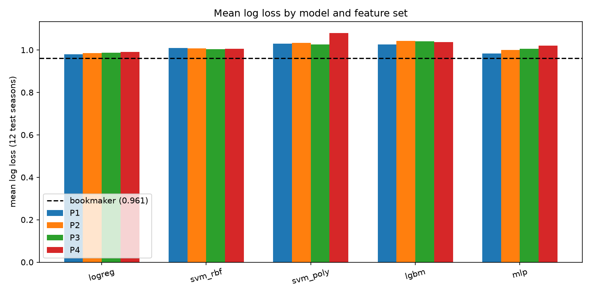
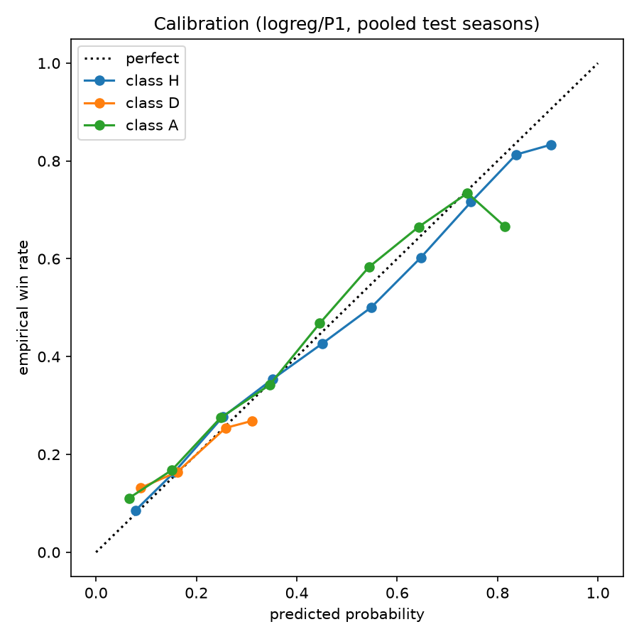
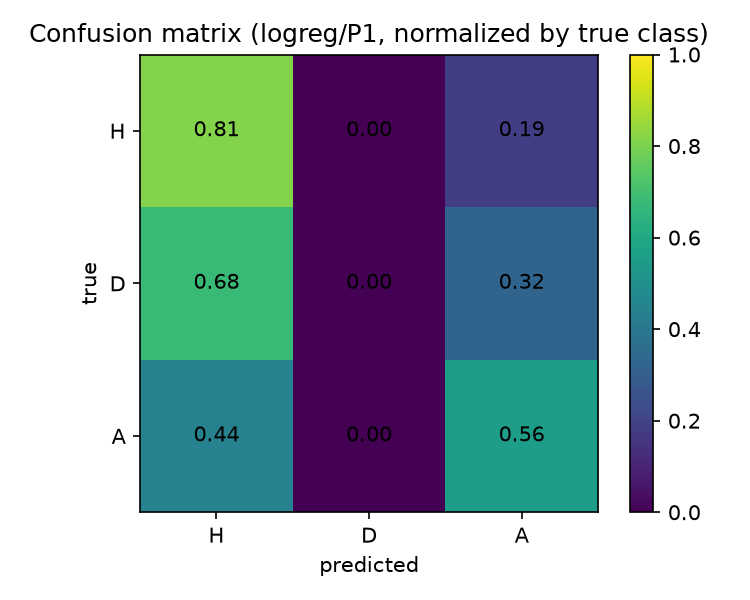
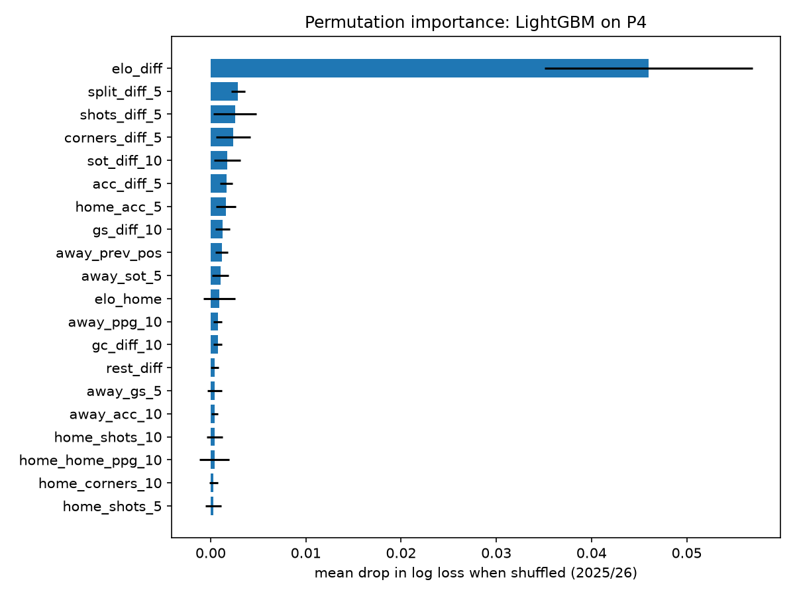

# inVAR

Predict English Premier League results (H/D/A) from pre-match information
only, and compare honestly against bookmaker odds. Every feature for match M
uses only matches dated strictly before M; evaluation is walk-forward by
season (train earlier, tune on the season before the test season, score the
test season once).

## Reproduce

```bash
pip install -e ".[dev]"
make all          # data -> features -> train -> eval -> plots
make table        # previous-season table baseline + logreg/PT
python -m pytest  # data, no-leakage, table and demo checks
make demo         # interactive current-season fixture demo
```

`make data` downloads the E0 season CSVs (2009/10–2025/26) from
football-data.co.uk into `data/raw` (read-only), writes
`data/processed/matches.parquet` (6,460 rows) plus a data card.
`make train` runs the full model grid (~50 min, mostly SVMs); per-model
chunks work too, e.g. `python -m epl.models --models logreg --sets P1`.
`make table` adds the previous-season table benchmark and the table-only
logreg/PT model (a couple of minutes), appending to `reports/results.csv`.
`python -m epl.leaky` is a one-off leakage demonstration (not part of
`make all`). Dependencies are pinned in `pyproject.toml`; all seeds are 42.
Detailed specs live in `docs/` (local-only, not committed).

## Live demo (fixtures you supply)

The canonical dataset ends at 2025/26. To predict the season you are
following, copy `data/fixtures.example.csv` to `data/fixtures.csv` (ignored
by git) and fill it in. Required columns are `date`, `home_team` and
`away_team`; the rest are optional:

| column | meaning |
| --- | --- |
| `date` | kickoff date, `YYYY-MM-DD` or `DD/MM/YYYY` |
| `home_team`, `away_team` | team names; common aliases are handled |
| `home_goals`, `away_goals` | full-time goals; required for played matches |
| `result` | `H/D/A`; derived from goals if omitted |
| `b365_home`, `b365_draw`, `b365_away` | decimal odds; benchmark only |
| `home_shots`, `away_shots`, `home_sot`, `away_sot`, `home_corners`, `away_corners` | optional stats for P3/P4 |
| `season` | inferred from `date` if omitted |

```bash
python -m epl.demo --fixtures data/fixtures.csv
python -m epl.demo --fixtures data/fixtures.csv --features P4
python -m epl.demo --historical 2025/26   # rehearse, then reveal the result
python -m epl.demo --leakage               # honest vs leaky comparison
python -m epl.demo --about                 # methodology talking points
python -m epl.demo                         # interactive menu
```

Each fixture is predicted by `logreg/P1` (fixed `C=1.0`, seed 42) trained on
matches dated strictly before that fixture. Imputation and scaling come from
that training block only. Rows with results update Elo/form for later fixtures
and are also backtested as-of kickoff. If you supply only upcoming fixtures,
form is anchored at the end of 2025/26; include completed current-season rows
to keep it current. Output uses `rich` when available and falls back to plain
text. The demo is an inference tool, not a new headline result:
`reports/results.csv` remains the walk-forward evaluation.

## Results (mean over 12 walk-forward test seasons, 2014/15–2025/26)

| model | set | log_loss | accuracy |
| --- | --- | --- | --- |
| bookmaker | none | 0.9611 | 0.5478 |
| logreg | P1 | 0.9804 | 0.5384 |
| mlp | P1 | 0.9834 | 0.5357 |
| logreg | P2 | 0.9850 | 0.5351 |
| logreg | P3 | 0.9878 | 0.5384 |
| logreg | P4 | 0.9909 | 0.5366 |
| mlp | P2 | 1.0004 | 0.5202 |
| svm_rbf | P3 | 1.0042 | 0.5303 |
| svm_rbf | P2 | 1.0066 | 0.5289 |
| svm_rbf | P4 | 1.0063 | 0.5316 |
| mlp | P3 | 1.0064 | 0.5235 |
| svm_rbf | P1 | 1.0093 | 0.5311 |
| mlp | P4 | 1.0211 | 0.5116 |
| lgbm | P1 | 1.0262 | 0.5134 |
| svm_poly | P3 | 1.0260 | 0.4868 |
| svm_poly | P1 | 1.0301 | 0.4904 |
| svm_poly | P2 | 1.0328 | 0.4785 |
| lgbm | P4 | 1.0367 | 0.5092 |
| lgbm | P3 | 1.0415 | 0.5154 |
| lgbm | P2 | 1.0424 | 0.5042 |
| class_priors | none | 1.0685 | 0.4441 |
| svm_poly | P4 | 1.0804 | 0.4884 |
| always_home | none | 2.5691 | 0.4441 |

No model beats the bookmaker on log loss or accuracy. The simplest feature
set (P1, Elo only) wins or ties for nearly every model; the P1→P4 ablation
(`reports/ablation.csv`) shows added form/shot/context features hurting more
often than helping. Full per-season rows: `reports/results.csv`.






Draw handling: base models almost never predict draws (draw recall 0–12%).
Class-weighted variants (`logreg_draww`, `lgbm_draww`) lift draw recall to
33–54% at a ~8-point accuracy cost; the `|pH−pA| < margin` decision rule
(margin tuned on the validation season) adds small recall gains for free.
See `reports/results.csv` (`*_drawrule`, `*_draww` rows).

### Table-only analysis

Using only the **previous season's final table** (rank, points, goal
difference), the "higher-placed team always wins" rule never predicts a draw
and reaches **0.5044** accuracy — better than class priors but well below the
bookmaker and Elo-only logreg. A logreg trained on the same table-gap
features (`PT`) reaches 1.0000 log loss / 0.5167 accuracy, so the table adds
little beyond what Elo already captures on its own. Promoted sides are ranked
21/22/23 by first appearance and inherit the prior season's 20th-placed
points/GD/GF as a proxy; details in `docs/featuresandmodels.md`.

| model | set | log_loss | accuracy |
| --- | --- | --- | --- |
| bookmaker | none | 0.9611 | 0.5478 |
| logreg | P1 | 0.9804 | 0.5384 |
| logreg | PT | 1.0000 | 0.5167 |
| class_priors | none | 1.0685 | 0.4441 |
| table_higher_wins | none | 2.2926 | 0.5044 |
| always_home | none | 2.5691 | 0.4441 |

## Leakage discussion

Guards: date-ordered Elo/rolling computation with same-date batching (same-day
kickoffs never see each other); median imputation and scaling fit on training
seasons only; hyperparameters tuned on the validation season, never the test
season; bookmaker odds used as a benchmark, never a training feature;
`tests/test_no_leakage.py` enforces truncation invariance (deleting later
matches leaves earlier features unchanged), same-date isolation, and clean
debut matches. Tripwires held: best accuracy 0.5478 (bookmaker) < 0.60, and
no model's log loss went below the bookmaker's 0.9611.

Leaky replication (`leaky_random80` row, `python -m epl.leaky`): random 80/20
split with full-season-average team features scores **0.5642** accuracy —
2.6 points above the honest walk-forward logreg/P1 (0.5384). The premium
comes from two future leaks: season averages that include the match itself
and later matches, plus shuffled time splits. (The paper's reported 58.89%
uses richer features; ours is a minimal demonstration of the mechanism, not
a like-for-like comparison.)

## Limitations

- Single league (EPL only); no test of transferability.
- No lineups, injuries, suspensions, or managerial changes.
- No expected-goals data for most seasons (shots/SoT used as proxies).
- Closing odds excluded from features by design; only B365/market-average
  pre-match odds used, as a benchmark.
- 380 matches per test season ⇒ single-season accuracy SE ≈ 2.5 points;
  gaps smaller than that across seasons are noise.
